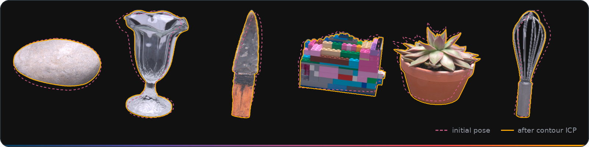

# contour-registration

[](LICENSE)
[](https://martine-benchmark.github.io/)
[](https://doi.org/10.7910/DVN/2BEPEH)
[](https://www.python.org/)
[](https://github.com/martine-benchmark/contour-registration/actions/workflows/tests.yml)

`contour-reg` aligns a 3D mesh to calibrated multi-view images by ICP on silhouette contours: from camera poses,
one mask per view and a roughly placed mesh, it finds the rigid (6-DoF) or similarity (7-DoF) transform. Built for the
[Martine benchmark](https://martine-benchmark.github.io/) to align its scanned meshes; works on any calibrated capture.

## Install

```bash
git clone https://github.com/martine-benchmark/contour-registration.git && cd contour-registration
uv sync                          # + `--extra segmentation` for SAM 3 masks (GPU recommended)
```

Needs [uv](https://docs.astral.sh/uv/) and Python 3.10+. Without uv: `pip install -e .` in a Python 3.10+ environment.

## Try it

Register the bundled low-resolution `lego` test fixture (8 views, masks only), in about a minute on 4 CPU cores:

```bash
uv run contour-reg pipeline --poses tests/data/lego/colmap --mesh tests/data/lego/mesh.ply \
    --masks tests/data/lego/masks -o out/lego
```

It writes:

```text
out/lego/result.json   final_pose [rx, ry, rz, tx, ty, tz] and scale, to apply to the mesh
out/lego/sweep/        one registration per Canny configuration, with their ranking
out/lego/plots/        sweep heatmap, ICP convergence, Pareto front
```

How to read and apply the pose: [docs/output.md](docs/output.md).

## Register your own capture

| Input | Format |
| :-- | :-- |
| Camera poses | Meshroom/AliceVision `sfm.json`, COLMAP model directory, or IDR `cameras.npz` (auto-detected) |
| Mesh | `.ply` or `.obj`, in the camera world frame and roughly aligned (the search starts from the identity) |
| Masks | One binary image per view, at the resolution of the calibration, object = non-zero |
| Images (optional) | One image per view; contours become Canny edges near the mask boundary instead of the mask boundary |

Masks and images are matched to the views by file name, extension aside (rules in
[docs/cli.md](docs/cli.md#matching-masks-and-images-to-views)).

```bash
uv run contour-reg pipeline --poses sfm.json --mesh mesh.ply --masks masks/ --images images/ -o out/
```

Add `--dof 7` when the mesh and the poses differ in scale (e.g. a metric scan and SfM poses).

## Main commands

| Command | Example |
| :-- | :-- |
| `pipeline`: Canny sweep, selection, refinement | `contour-reg pipeline --poses sfm.json --mesh mesh.ply --masks masks/ -o out/` |
| `eval-loo`: leave-one-view-out error, without ground truth | `contour-reg eval-loo --poses sfm.json --mesh mesh.ply --contours contours/ -o loo.json` |
| `segment`: masks from a text prompt (SAM 3 extra) | `contour-reg segment --images images/ --prompt "object" --output masks/` |

All commands and options: [docs/cli.md](docs/cli.md) or `contour-reg <command> --help`.
[examples/martine/](examples/martine/) holds the settings used for the Martine benchmark.

## When it does not fit

- The camera poses must be calibrated: `contour-reg` moves the mesh, never the cameras.
- The mesh must start roughly in place (a few degrees off, shifted by a small fraction of its size): ICP is a local search.
- The object should be seen whole in each view: a silhouette cut by the image border gives false contours.

## Documentation

- [docs/cli.md](docs/cli.md): every command and option, with defaults.
- [docs/method.md](docs/method.md): objective, coarse-to-fine ICP, Canny sweep, selection criterion, LOO.
- [docs/output.md](docs/output.md): output files, pose convention, applying the transform.
- [docs/segmentation.md](docs/segmentation.md): SAM 3 masks (gated weights, GPU, SLURM example).

## Tests

```bash
uv run pytest
```

About two minutes on a CPU. GPU-only paths (SAM 3 inference) are mocked or skipped. The fixtures in
`tests/data/` (`lego`, `spine`, `surgery_scissors`: downscaled images, masks, meshes and the three
pose formats) come from the Martine dataset.

## License

Code: MIT, see [LICENSE](LICENSE). The test fixtures in `tests/data/` are derived from the Martine
dataset and licensed under [CC BY 4.0](https://creativecommons.org/licenses/by/4.0/) (see
[tests/data/README.md](tests/data/README.md)).

## Citation

```bibtex
@inproceedings{martine2026,
  title={Martine: Benchmarking Multi-View 3D Surface Reconstruction Across Viewpoint Coverage, Resolution, and Lighting},
  author={Bruneau, Robin and Brument, Baptiste and Giraud, Frederic and Sigrist, Bastian and Jecklin, Sascha and Fürnstahl, Philipp and Menze, Bjoern and Calvet, Lilian},
  booktitle={NeurIPS Evaluations \& Datasets (E\&D) Track},
  year={2026}
}
```
