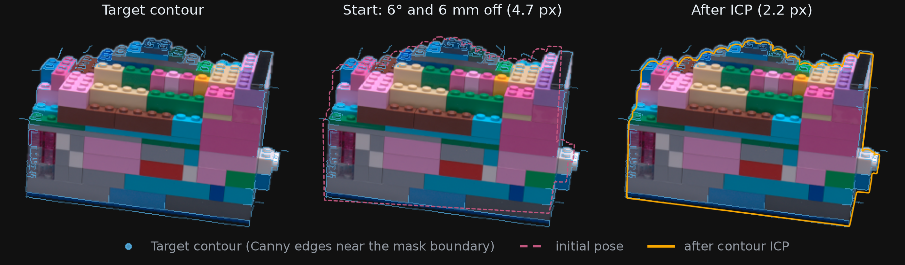

# Method

How `contour-reg` turns masks (and images) into a registered pose: target contours, ICP objective,
coarse-to-fine refinement, Canny sweep, selection criterion and leave-one-view-out estimate.

## Target contours

For each view, the target contour is a set of 2D points:

- **mask boundary** (no images): the outer boundary of the mask (holes with `--include-inner-contours`);
- **Canny** (`--images`): Canny edges of the image kept inside a band of ±`margin` px around the mask
  boundary, `C = Canny(I) ∩ band(M)`. Sobel kernels larger than 7 use a built-in Canny
  (Sobel gradients, non-maximum suppression, hysteresis), since OpenCV's `Canny` stops at 7.

## Objective

The mesh is transformed by `T(v) = s·R·v + t` (`s = 1` for `--dof 6`) and its silhouette is extracted
in each view: edges whose two faces have opposite visibility, plus open-boundary edges, filtered by
rasterization to keep only occluding contour points. For every target contour point, the nearest
projected silhouette vertex is found with a KD-tree; the parameters minimise the sum over all views
of these distances (px) with a robust soft-ℓ1 loss (SciPy trust-region reflective solver). The
projection uses each camera's intrinsics and radial distortion.

*One view of the Martine `lego` object. The ground-truth mesh was moved away from its registered pose
and registered back by `refine` on 22 of the 84 views (Canny 20/60, band of ±10 px). In brackets: mean
distance from the silhouette to the silhouette at the published registration, in image pixels. Script:
[assets/make_figure.py](assets/make_figure.py).*

## Coarse-to-fine ICP

One ICP run (`register`, and each sweep configuration) alternates correspondences and pose updates
until the error change falls below 1e-3 px; a step is accepted only if it lowers the error on the
same correspondences. It then re-optimises on the closest `--error-percentile` % of correspondences
(75 by default; 100 disables this trimmed phase). `refine` and the end of `pipeline` chain two such
runs: a coarse one (trim 75 %) from the sweep pose, then a fine one keeping the best 90 %
(`--keep-pct`). With `--dof 7`, the fine run starts from the scale found by the coarse one.

## Canny sweep

Canny thresholds strongly change which edges survive (texture, shadows, specular highlights). The
sweep registers the mesh once per configuration of a grid, by default low ∈ {5, 10, 20, 50} ×
high ∈ {20, 30, 40, 60, 80, 120} with low < high (20 configurations), with a shared Sobel kernel and
margin.

## Selection criterion (`pipeline`, `eval-canny`)

The reprojection error of a configuration is not comparable across configurations: a sparse contour
that keeps only easy edges has a low error. The configuration is therefore chosen by how well its
contour overlaps the mesh silhouette at its own registered pose. With `S` the projected silhouette,
`C` the contour, `C_trim` its 75 % of points closest to `S`, and a tolerance `ε`:

- silhouette coverage `T_R = |{s ∈ S : d(s, C) ≤ ε}| / |S|` (recall);
- precision after trimming `P_trim = |{c ∈ C_trim : d(c, S) ≤ ε}| / |C_trim|`;
- `F_β = (1 + β²)·P_trim·T_R / (β²·P_trim + T_R)`, counts summed over all views.

`pipeline` refines the configuration with the highest F0.5 (precision-weighted) at ε = 2 px and
writes the full ranking to `sweep/eval_canny.json`. If every configuration scores F0.5 = 0 (no contour
point within 2 px of the silhouette in any view), it stops with an error instead of picking one
arbitrarily: the initial pose is too far or the contours are wrong. `--select-by error` restores the
lowest-reprojection-error choice. `eval-canny` computes the same scores for a sweep directory, with
other ε, β or trim values if needed.

## Leave-one-view-out (`eval-loo`)

Without a reference pose, registration quality can be estimated by self-consistency: for each view,
register on the other views and measure the contour-to-silhouette distance on the held-out one. The
median and spread of the held-out errors (px) indicate how well a pose estimated from some views
predicts the others.
